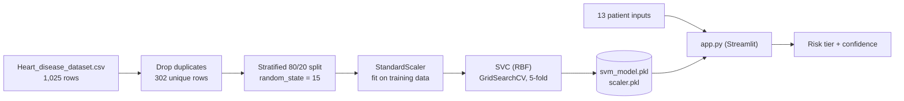
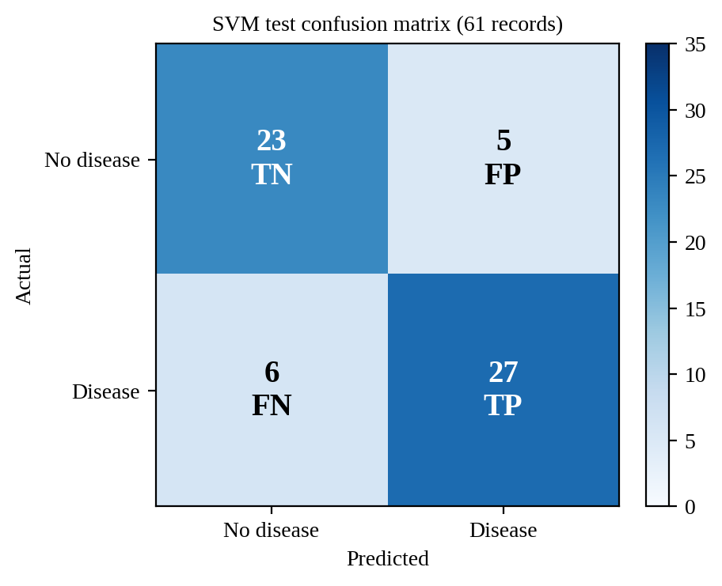

<div align="center">

# ❤️ HeartCure

### Heart Disease Prediction Using SVM

A Streamlit web app that estimates heart disease risk from 13 clinical indicators with a tuned RBF Support Vector Machine.


-c52222)


</div>

> ⚠️ **Educational project.** HeartCure is not a medical device and must not be used for diagnosis or treatment decisions. See the [disclaimer](#️-medical-disclaimer).

## 📑 Table of Contents

- [Overview](#-overview)
- [Features](#-features)
- [How It Works](#-how-it-works)
- [Dataset](#-dataset)
- [Model and Results](#-model-and-results)
- [Tech Stack](#️-tech-stack)
- [Project Structure](#-project-structure)
- [Getting Started](#-getting-started)
- [Using the App](#-using-the-app)
- [Retraining the Model](#-retraining-the-model)
- [Deployment](#️-deployment)
- [Troubleshooting](#-troubleshooting)
- [Limitations](#-limitations)
- [Roadmap](#️-roadmap)
- [Team](#-team)
- [Medical Disclaimer](#️-medical-disclaimer)

## 📌 Overview

Heart disease assessment depends on many measurements at once: age, blood pressure, cholesterol, ECG results and more. HeartCure trains a Support Vector Machine on a heart disease dataset and wraps it in a clean web interface. You enter a patient's 13 clinical values, and the app returns a risk tier (Low, Moderate or High), a confidence figure and a short advisory message.

The training code (`model.py`) and the web app (`app.py`) are kept separate: training saves a fitted scaler and model to disk, and the app only loads them, so the model is never retrained while the app is running.

## 🌟 Features

| Feature | Details |
|---|---|
| **Patient form** | 13 clinical inputs with friendly labels (for example "Typical Angina" instead of a code) and input limits |
| **Tuned SVM** | RBF-kernel SVM tuned with 5-fold cross-validated grid search |
| **Risk tiers** | Low, Moderate or High risk, with a confidence percentage and an advisory message for each tier |
| **Prediction history** | Every prediction in the session is added to a History page, which can be cleared |
| **Multi-page UI** | Home, Predict, Result, History and About pages with a sidebar and custom medical styling |
| **Fast startup** | Model and scaler load once and are cached |
| **Clear errors** | If the model files are missing, the app shows a message instead of crashing |

## 🧭 How It Works



**From inputs to a risk tier**

1. The 13 form values are placed in the same column order as the training data.
2. The saved scaler standardises them exactly as during training.
3. The SVM predicts the class and returns its decision value.
4. The decision value is passed through a sigmoid to give a score between 0 and 1.
5. The score is mapped to a tier: **High Risk** at 0.60 or above, **Moderate Risk** from 0.40 to 0.60, **Low Risk** below 0.40.

> The score is a sigmoid of the SVM decision value. It helps rank risk but is **not** a calibrated clinical probability.

## 📊 Dataset

`Heart_disease_dataset.csv` contains 1,025 rows. Removing 723 duplicate rows leaves **302 unique patient records**, which are used for training and testing. Each row has 13 input features and a binary target (`1` = heart disease present, `0` = absent).

| Feature | Meaning |
|---|---|
| `age` | Age in years |
| `sex` | 1 = male, 0 = female |
| `cp` | Chest pain type |
| `trestbps` | Resting blood pressure (mm Hg) |
| `chol` | Serum cholesterol (mg/dl) |
| `fbs` | Fasting blood sugar above 120 mg/dl (1 = yes, 0 = no) |
| `restecg` | Resting ECG result |
| `thalach` | Maximum heart rate achieved |
| `exang` | Exercise-induced angina (1 = yes, 0 = no) |
| `oldpeak` | ST depression induced by exercise |
| `slope` | Slope of the peak exercise ST segment |
| `ca` | Number of major vessels seen by fluoroscopy |
| `thal` | Thalassemia test result |

## 🧪 Model and Results

| Step | Choice |
|---|---|
| Split | 80% train / 20% test, stratified, `random_state=15` |
| Scaling | `StandardScaler`, fitted on the training data only |
| Kernel comparison | Linear, polynomial and RBF compared with default settings |
| Tuning | `GridSearchCV`, 5-fold, scored on accuracy |
| Search grid | `C` in 0.1, 1, 10, 100 and `gamma` in scale, 0.01, 0.1, 1 (RBF kernel) |
| Best setting | `C = 10`, `gamma = 0.01` |
| Saved files | `svm_model.pkl` (model), `scaler.pkl` (scaler) |

**Held-out test results (61 records)**

| Metric | Value |
|---|---|
| Accuracy | 81.97% |
| Precision | 84.38% |
| Recall | 81.82% |
| F1-score | 83.08% |
| Specificity | 82.14% |
| Baseline (always predict the majority class) | 54.10% |

<div align="center">



</div>

The model makes 5 false positives and 6 false negatives on the 61 test records. The test set is small, so treat these numbers as an estimate with real uncertainty. Run `python model.py` to reproduce the figures on your machine.

## 🛠️ Tech Stack

| Layer | Technology |
|---|---|
| App framework | [Streamlit](https://streamlit.io/) with custom HTML and CSS |
| Machine learning | [scikit-learn](https://scikit-learn.org/) (`SVC`, `StandardScaler`, `GridSearchCV`) |
| Data handling | [Pandas](https://pandas.pydata.org/), [NumPy](https://numpy.org/) |
| Model storage | [Joblib](https://joblib.readthedocs.io/) |
| Plots (training script) | [Matplotlib](https://matplotlib.org/) |

## 📂 Project Structure

```
HeartCure/
├── .streamlit/
│   └── config.toml           # Streamlit theme and UI settings
├── assets/                   # Images used by the app
│   ├── cardiac_ai_blended.png
│   ├── cardiac_ai_hero.png
│   ├── doctor.jpg
│   └── heart_3d.jpg
├── docs/
│   └── images/
│       └── confusion_matrix.png
├── app.py                    # Streamlit web application
├── model.py                  # Training, tuning and evaluation script
├── Heart_disease_dataset.csv # Dataset
├── svm_model.pkl             # Trained SVM
├── scaler.pkl                # Fitted StandardScaler
├── requirements.txt          # Python dependencies
├── .gitignore
└── README.md
```

## 🚀 Getting Started

### Prerequisites

- Python 3.9 or newer
- `pip` and `git`

### 1. Clone the repository

```bash
git clone https://github.com/Hasini2706/HeartCure.git
cd HeartCure
```

### 2. Create a virtual environment (recommended)

```bash
python -m venv venv
# Windows
venv\Scripts\activate
# macOS / Linux
source venv/bin/activate
```

### 3. Install dependencies

```bash
pip install -r requirements.txt
```

### 4. Run the app

```bash
streamlit run app.py
```

Open `http://localhost:8501` in your browser.

## 🩺 Using the App

1. Open **Predict** from the sidebar (or press **Predict Now** on the Home page).
2. Fill in the patient's 13 values. The form accepts these ranges:

   | Input | Allowed range |
   |---|---|
   | Age | 1 to 120 years |
   | Resting blood pressure | 50 to 250 mm Hg |
   | Cholesterol | 50 to 700 mg/dl |
   | Maximum heart rate | 50 to 250 |
   | ST depression (oldpeak) | 0.0 to 10.0 |
   | Major vessels | 0 to 4 (the dataset uses 0 to 3) |

3. Press **Predict Heart Disease Risk**.
4. Read the **Result** page: risk tier, confidence and advisory message.
5. Open **History** to review earlier predictions from this session.

## 📊 Retraining the Model

To retrain the SVM and regenerate `svm_model.pkl` and `scaler.pkl`:

```bash
python model.py
```

The script removes duplicates, splits and scales the data, compares kernels, runs the grid search, prints the metrics and saves the two files. Retrain in the same environment you use to run the app, because saved models depend on the scikit-learn version.

## ☁️ Deployment

HeartCure can be hosted free on [Streamlit Community Cloud](https://streamlit.io/cloud):

1. Push the repository to GitHub (with `svm_model.pkl` and `scaler.pkl` included).
2. Sign in to Streamlit Community Cloud and choose **New app**.
3. Select the repository `Hasini2706/HeartCure`, branch `main`, and main file `app.py`.
4. Click **Deploy**. Dependencies are installed from `requirements.txt`.

## 🩹 Troubleshooting

| Problem | Fix |
|---|---|
| "Clinical model artifacts could not be loaded" | `svm_model.pkl` or `scaler.pkl` is missing. Run `python model.py`, and start the app from the project folder |
| Warning about scikit-learn versions when loading the model | The saved files were made with a different scikit-learn version. Run `python model.py` again to regenerate them |
| `streamlit: command not found` | Activate your virtual environment, or run `python -m streamlit run app.py` |
| Port 8501 already in use | Run `streamlit run app.py --server.port 8502` |

## ⚠️ Limitations

- Only 302 unique records are used, and the test set has 61 records.
- The model has not been validated on independent datasets.
- The displayed score comes from a sigmoid of the SVM decision value and is not a calibrated probability.
- The History page is stored in the browser session only and is cleared when the session ends.
- The risk tiers use fixed thresholds (0.40 and 0.60) that have not been clinically validated.

## 🗺️ Roadmap

- [ ] Validate on independent heart disease datasets
- [ ] Calibrate the output so scores read as true probabilities
- [ ] Add SHAP-based explanations for each prediction
- [ ] Compare the SVM with other classifiers on the same split
- [ ] Add automated tests for the preprocessing and prediction code
- [ ] Add downloadable prediction reports

## 👥 Team

Department of Artificial Intelligence and Machine Learning, Aditya University, under the guidance of **Mr. G. Siva Shankar** (Assistant Professor, AIML).

- Kadali Swarna Latha (24B11AI151)
- Konda Sasi Meghana (24B11AI194)
- Madabattula Tejo Hasini (24B11AI223)
- Oduri Bheemeswari (24B11AI305)

## ⚠️ Medical Disclaimer

This application is built for educational purposes and clinical decision-support research. It is not intended to replace professional medical diagnosis, advice or treatment. Always consult a qualified healthcare professional for medical evaluation.
